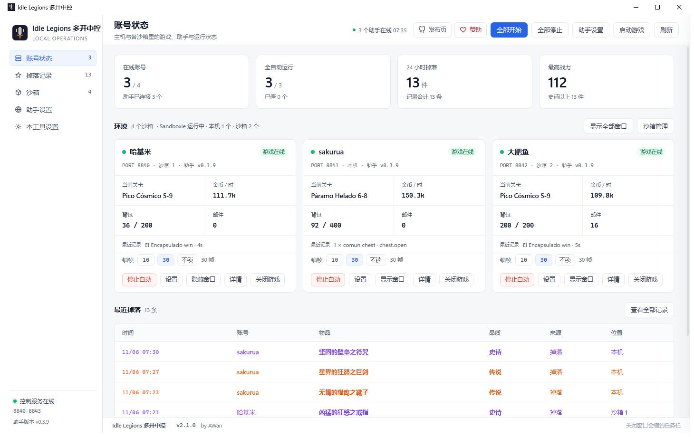

# Idle Legions 多开中控

把主机和各个 Sandboxie 沙箱里的 **Idle Legions** 客户端收进一个窗口：账号状态、掉落记录、沙箱部署、批量启停、锁帧与窗口管理。非官方玩家工具。

> 本仓库只包含控制台本身（前端资源 + 打包工具），不含游戏本体，也不含 X1X 助手本体。

## 截图



## 功能

- **账号状态**：每个实例一屏看全 —— 在线、自动、关卡、金币/时、背包、邮件、最近动作。
- **掉落记录**：整行按品质上色（物品 / 品质 / 来源 / 位置同一色相），可按稀有度与来源筛选。
- **沙箱**：Sandboxie 探测、逐箱部署助手、逐箱启停，游戏进程一览。
- **锁帧**：账号卡片上直接选 `10 / 30 / 不锁`，写该实例自己的 `settings.cfg`；重启实例生效。
- **部署**：主机或任一沙箱一键部署助手，端口在 8840–8843 之间扫描并随实例回报。
- **检测更新**：只比较版本号，界面不显示仓库地址；状态区分 检查中 / 已是最新 / 有新版本 / 检测失败。
- **顶栏与页脚**：发布页、赞助两个图标；页脚常驻版本号与署名。

## 下载

到 [Releases](https://github.com/buguniaoOVO/idle-legions-console/releases) 下载 `IdleLegionsConsole-*-win-x64.zip`，解压即用。
需要 Windows 10/11 x64 与 Edge WebView2 Runtime（系统一般自带）；沙箱功能需要 Sandboxie Plus。

## 构建

这个 exe 是 PyInstaller 单文件程序，原始 `.py` 源码不在仓库里，能改的是**前端资源、窗口标题常量和图标**。
`console-src/` 就是这些可改部分 + 重新打包的工具：

```
console-src/
  web/                 页面（index.html / app.js / style.css / logo.png）
  assets/icon/         exe 图标（取自游戏 client.exe 的图标资源）
  tools/repack.py      重写 PyInstaller 归档：替换/新增 web 资源
  tools/patch_main.py  改主脚本里的窗口标题常量
  tools/patch_icon.py  原地换 PE 图标资源（不破坏归档）
  build.ps1            一条龙：标题 → 资源 → 图标 → 输出 exe
```

```powershell
powershell -ExecutionPolicy Bypass -File .\console-src\build.ps1 -Source <原始 exe> -Out <输出 exe>
```

> 每次构建都从**原始 exe** 出发，别在改过的 exe 上叠加。

## 免责声明

非官方工具，与游戏开发商及 X1X 无隶属关系；只做本机进程、窗口与文件层面的管理，不修改游戏内存。
使用风险自负，请遵守游戏与平台的服务条款。
